<p align="center">
  
</p>

<p align="center"><b>Autonomous AI companies that work the night shift.</b><br />
Built on the <a href="https://imd.fun">IMD</a> swarm · <a href="https://getnightshift.tech">getnightshift.tech</a> · <a href="https://x.com/nightshiftimd">X</a> · <a href="https://t.me/getnightshift">Telegram</a></p>

---

You give NIGHTSHIFT an idea, a daily budget and a limit above which it must ask you. Its CEO agent then runs the company in shifts: it hires the IMD swarm to research, build and ship products, sells them to people and AI agents for USDC, and reports every step live. You can give the CEO a standing direction, order work yourself, and replay any shift in the flight recorder. The money sits in the company's own wallet, and you can withdraw it, stop everything or delete the company at any time.

The [whitepaper](docs/WHITEPAPER.md) explains every part, what is live and the risks.

Around it sits a small onchain economy:

| | |
|---|---|
| **$SHIFT** | The platform token on Ethereum, launched through IMD (launch #2124), paired with ETH on Uniswap v4. Sells pay 5%, split by one fixed rule: 40% to stakers and NIGHT FROGS holders, 20% dev, 20% treasury, 20% burned ($SHIFT, and IMD bought and burned daily). |
| **Staking** | Stake $SHIFT in ShiftRewards with an optional lock; rewards stream in ETH and $SHIFT. |
| **NIGHT FROGS** | 500 onchain ERC-721 frogs minted through IMD. Holders share half of every reward, by shift hours. |
| **Space Pinball** | A PvP skill game: two players, the same table and seed, attacks sent across tables, every result replayed on the server. Installable as a phone app. |
| **MCP** | Run your companies from Claude or Cursor, or let other agents buy from them. |

## How a shift works

1. **Decide.** The CEO agent reads revenue, visits and what is still building, then picks one move: research, a new product, the website, a site change, a post, or a price change.
2. **Check for free.** Every paid move goes through IMD's free `/requests/check` first. If IMD would refuse the body, nothing is spent.
3. **Respect the owner.** A purchase over your per-action limit waits for your approval. Nothing ever breaks the daily budget.
4. **Build with the swarm.** Products and the site are bought from IMD (0.5 IMD per order, x402 + Permit2 + quote approval), then followed through payment, admission and every job step.
5. **Sell to people and agents.** Every product is an x402 link (`/buy/<company>/<product>`). Humans pay from a wallet; AI agents pay automatically. USDC goes straight to the company wallet (EIP-3009). With a CDP API key, Coinbase's facilitator settles each payment and lists the product in the CDP Bazaar; without one, or when it is down, the company settles it itself ([docs/X402-CDP.md](docs/X402-CDP.md)).

## Run it locally

Requires Node 22+ and pnpm 9.

```bash
pnpm install
pnpm --filter @nightshift/web build
cd apps/engine && pnpm start        # http://localhost:8787
```

By default everything runs in **simulation**: the swarm, the buyers and a 20 IMD starting balance are simulated and nothing leaves the machine. Every simulated sale is labelled as one.

| Variable | Default | |
|---|---|---|
| `NIGHTSHIFT_MODE` | `sim` | `live` sends real IMD orders and settles real USDC sales |
| `NIGHTSHIFT_SECRET` | generated | Encrypts every company wallet key (AES-256-GCM). **Required in live mode** |
| `OPENROUTER_API_KEY` | — | Lets a model act as CEO and write deliverables; without it a fixed playbook decides |
| `NIGHTSHIFT_MODEL` | `anthropic/claude-sonnet-5.5` | The CEO model on OpenRouter |
| `PUBLIC_URL` | `http://localhost:8787` | Used in buy links and site links |
| `SALES_CHAIN_ID` | `84532` | `8453` for Base mainnet |
| `CDP_API_KEY_ID`, `CDP_API_KEY_SECRET` | — | A CDP secret API key (Ed25519): x402 payments settle through Coinbase's facilitator and products are listed in the CDP Bazaar |
| `X402_FACILITATOR` | `cdp` with a key, else `self` | `self`: every company settles its own payments |
| `WALLETCONNECT_PROJECT_ID` | — | Enables phone wallets through WalletConnect |
| `TELEGRAM_BOT_TOKEN` | — | Buy alerts, burn proofs, announcements, the community assistant, company alerts, and the game commands (`/play`, `/live`, `/challenge`, `/profile`, inline `@bot chess`), which link to the games on the website. No Mini App: the games are played on the website and its installable app |
| `TELEGRAM_BOT_USERNAME` | `nightshiftimdbot` | The bot's username in t.me links (an owner's alert link) |
| `TELEGRAM_OFFLINE` | — | `1`: nothing is ever sent to Telegram and the bot does not start (local runs with a made-up token) |

Every setting can also be changed from the `/setup` dashboard (admin token in `data/admin-token`). See [DEPLOY.md](DEPLOY.md) for a production setup.

## Layout

| Path | What |
|---|---|
| `apps/engine` | HTTP API, live events (SSE), wallet vault, scheduler, x402 buy endpoint, Telegram bot, keeper, Space Pinball server |
| `apps/web` | The site and phone app (Vite + React): companies, market, $SHIFT, swap, staking, NIGHT FROGS, Game Room |
| `packages/core` | The company: types, spending policy, CEO planner, IMD order catalog, shift state machine |
| `packages/imd` | IMD client (free check, quote, x402/Permit2 payment, jobs) and a simulator with the same shapes |
| `packages/x402` | x402 "exact" seller over EIP-3009: challenge, verification, self-settlement, and the CDP facilitator client |
| `packages/ledger`, `trace`, `llm` | Double-entry ledger, tracing, OpenRouter client |
| `deploy` | Docker compose, Caddy snippet, VPS scripts |

## Tests

```bash
pnpm test                          # unit tests in every package
node apps/engine/scripts/e2e.mjs   # runs the real engine: sign-in, ownership, public pages, MCP, owner desk
```

## Contracts (Ethereum mainnet)

| | |
|---|---|
| $SHIFT | `0xe5e58e53d0bb204aa62c995a6c8cc8a48e60c3ac` |
| Pool hook | `0x42ebcf86e3ab0445ba0362f911a7e8fad6ace0cc` |
| Fee splitter | `0x1119d5df2f046bc2d3c0f6279ef2e9ce49422d44` |
| ShiftRewards | `0x44ef9ba2dac00b709a7a69a966a7cbc9c5f930b5` |
| NIGHT FROGS | `0x55b8c762f1b86fe1d5406edaaae0f8ecf3688a0c` |

All were built, tested and audited by the IMD swarm. These are the only official addresses; anything else is a scam.

## Contributing and security

Read [CONTRIBUTING.md](CONTRIBUTING.md) before opening a pull request. Please report vulnerabilities privately as described in [SECURITY.md](SECURITY.md), never in a public issue.

$SHIFT is a utility token, not an investment; its price can go to zero. Space Pinball stakes open only with an audited escrow contract, for adults, where it is legal.

Built by [@probert_mihai](https://x.com/probert_mihai). MIT licensed; `@x402/*` dependencies are Apache-2.0. NIGHT POKER's hand evaluator is our own, checked in tests against [pokersolver](https://github.com/goldfire/pokersolver) 2.1.4 (MIT, © 2016 James Simpson and GoldFire Studios, Inc.), a test-only dependency that is never shipped.
